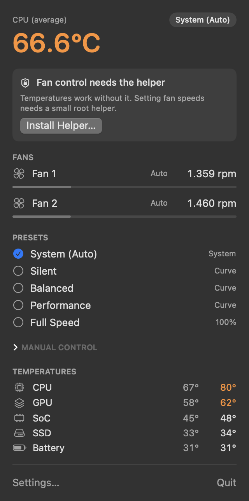
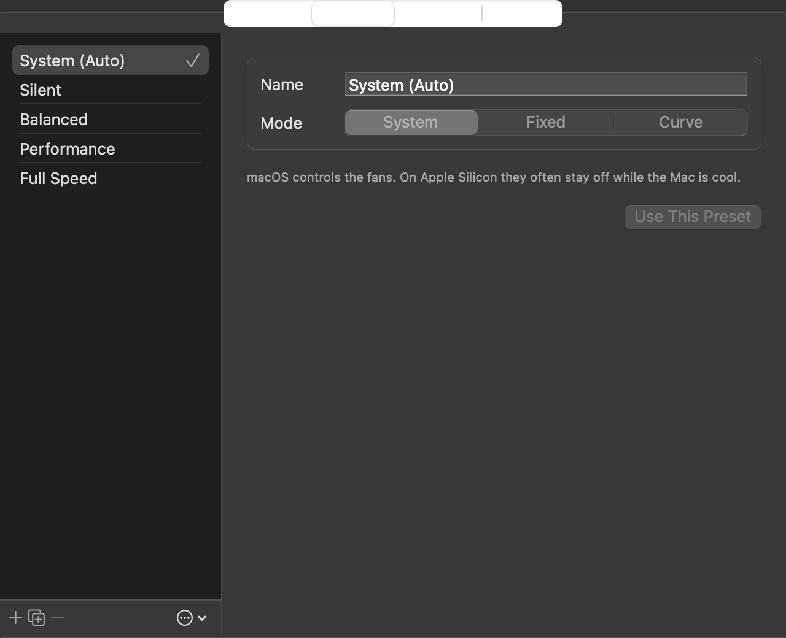

<p align="center">
  
</p>

<h1 align="center">MDMacFanKit</h1>

<p align="center">
  <a href="https://github.com/amd1292/MDMacFanKit/actions/workflows/build.yml"></a>
  <a href="LICENSE"></a>
  
  <a href="https://github.com/amd1292/MDMacFanKit/releases/latest"></a>
</p>

<p align="center">A free, open-source menu bar app for watching your Mac's temperatures and controlling its fans.</p>

<p align="center">
  
  
</p>

## Features

- **One temperature in the menu bar.** Pick the source (CPU average, hottest CPU core, GPU, hottest sensor, or any single sensor) and the style: icon, temperature, icon + temperature, or temperature + fan speed.
- **Presets one click away.** *System (Auto)*, *Silent*, *Balanced*, *Performance*, *Full Speed*, plus any you create.
- **Your own presets.** A fixed speed, or a temperature curve that follows any sensor, edited with a live chart.
- **Manual sliders** for each fan, straight from the menu.
- **Every sensor.** CPU cores, GPU, SoC, SSD and battery, read from the SMC and the IOHID temperature services.
- **Safe by default.** Quitting, crashing or uninstalling always hands the fans back to macOS.

## Requirements

- macOS 14 Sonoma or later
- A Mac with fans. Developed on Apple Silicon (M2 Pro MacBook Pro, macOS 26). Intel Macs use different SMC keys and are untested; reports are welcome.

## Install

### Download

1. Download `MDMacFanKit-<version>-arm64.zip` from the [latest release](https://github.com/amd1292/MDMacFanKit/releases/latest) (Apple Silicon).
2. Unzip it and move `MDMacFanKit.app` to `/Applications`.
3. Open it. The app is free and not notarized by Apple, so the first launch is blocked with *"Apple could not verify…"*. Click **Done**, then go to *System Settings → Privacy & Security*, scroll down and click **Open Anyway** next to MDMacFanKit. You only need to do this once.

   Or, from Terminal:

   ```bash
   xattr -dr com.apple.quarantine /Applications/MDMacFanKit.app
   ```

Intel Macs: build from source (below); there is no Intel download yet.

### Build from source

Only the Command Line Tools are needed (`xcode-select --install`); Xcode is optional.

```bash
git clone https://github.com/amd1292/MDMacFanKit.git
cd MDMacFanKit
./scripts/build-app.sh
open build/MDMacFanKit.app
```

Copy `build/MDMacFanKit.app` to `/Applications` to keep it. To start it automatically, turn on *Settings → General → Launch at login*.

## Fan control and the helper

Reading temperatures and fan speeds works for any user. **Setting** fan speeds means writing to the SMC, which only root can do, so the app installs a small LaunchDaemon (`com.mdmacfankit.helper`) the first time you click **Install Helper…**. macOS asks for your administrator password once.

The helper is deliberately conservative:

- every target speed is clamped to that fan's own minimum and maximum;
- all fans go back to automatic when the app quits or crashes, when it stops sending heartbeats for 15 seconds, when the helper starts, and when the helper is stopped;
- if macOS takes a fan back (thermal management, sleep), the helper re-applies the requested speed.

Uninstall it from *Settings → Helper → Uninstall…*, or:

```bash
sudo /Applications/MDMacFanKit.app/Contents/Resources/uninstall-helper.sh
```

### Why curves start with "auto"

On Apple Silicon, macOS often keeps the fans fully **off** while the Mac is cool, but manual mode can never go below a fan's minimum (about 1,300–1,500 rpm). A "silent" preset that pinned the fans at their minimum would be *louder* than macOS. So below a curve's first point the fans are left to macOS, and the app takes over only above it, with 3 °C of hysteresis so it doesn't flip back and forth.

The default curves follow the CPU average and start late (70–80 °C) because Apple Silicon cores routinely run at 70–80 °C under light load with the fans off. Tune them to taste in *Settings → Presets*.

### Running alongside other fan tools

Don't run Macs Fan Control or any other fan utility at the same time; the two would fight over the fans. MDMacFanKit warns you when Macs Fan Control is running.

## Command-line tool

`mdfan` ships inside the app bundle (`MDMacFanKit.app/Contents/Resources/mdfan`), or build it with `swift build -c release --product mdfan`:

```text
mdfan fans             list fans: speed, limits, mode
mdfan temps            list every temperature sensor
mdfan read F0Ac        read a raw SMC key
sudo mdfan set 0 2500  fan 1 to manual at 2500 rpm
sudo mdfan auto        all fans back to automatic
```

`mdfan` talks to the SMC directly, without the helper, which makes it handy for testing a new Mac model.

## Troubleshooting

| Symptom | What to do |
| --- | --- |
| The menu says *Fan control needs the helper* | Click **Install Helper…** and enter your password. |
| Fans don't follow a preset | Make sure no other fan tool is running. Check `sudo launchctl print system/com.mdmacfankit.helper` shows `state = running`. |
| A fan stays at 0 rpm in a curve preset | That is macOS in charge below the curve's first point. Lower the first point, or use a *Fixed* preset. |
| Want to see what the helper does | `/usr/bin/log show --last 10m --predicate 'process == "com.mdmacfankit.helper"'` |

## How it works

| Path | What it is |
| --- | --- |
| `Sources/MDFanCore` | SMC access, fan model, sensor reading, the helper's XPC protocol |
| `Sources/CPrivate` | Declarations for the private IOHIDEventSystem API (named temperature sensors) |
| `Sources/MDFanHelper` | The root LaunchDaemon that performs SMC writes |
| `Sources/MDMacFanKit` | The SwiftUI menu bar app |
| `Sources/mdfan` | The command-line tool |
| `scripts/` | Bundle build, release zip, icon generator, helper install/uninstall |

The app samples sensors every 1–5 seconds (configurable), works out the speed each fan should have from the active preset, and sends only the changes to the helper over XPC. Presets are stored in `~/Library/Application Support/MDMacFanKit/presets.json`.

## Security

The helper runs as root, so it accepts only fan commands, and every speed is clamped to the hardware limits. The app and helper are signed ad hoc, so the helper cannot verify the code signature of the process talking to it: any local process could ask it to change fan speeds, within the fans' limits. See [SECURITY.md](SECURITY.md) to report a vulnerability.

## Contributing

Bug reports, Mac-model reports and pull requests are welcome. Read [CONTRIBUTING.md](CONTRIBUTING.md) first; it covers building, testing on real hardware and the commit style.

## Disclaimer

This software changes how your Mac cools itself. It is provided as is, without warranty. The authors are not responsible for any damage. When in doubt, choose *System (Auto)* or quit the app; macOS takes the fans back immediately.

## License

[MIT](LICENSE)
